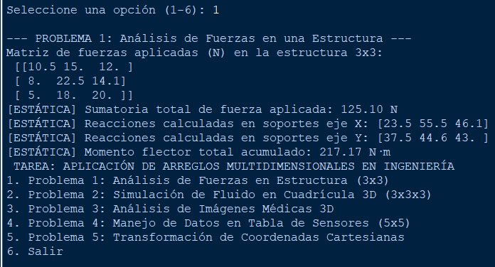
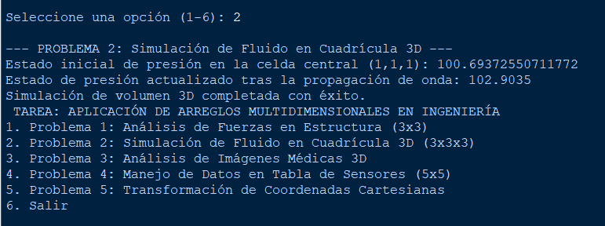
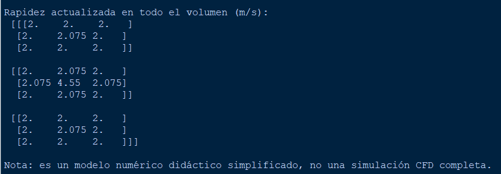
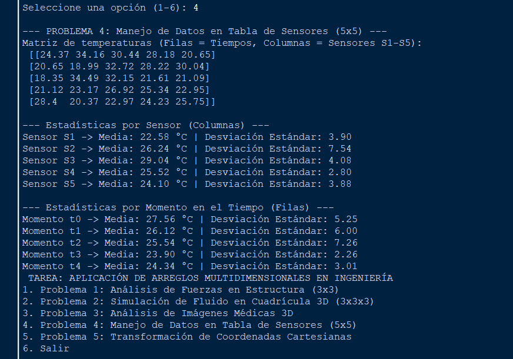
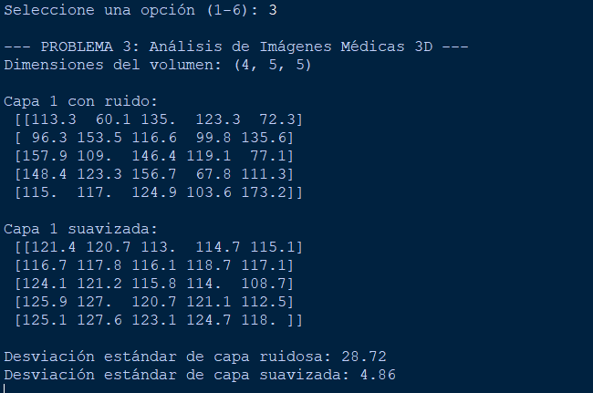
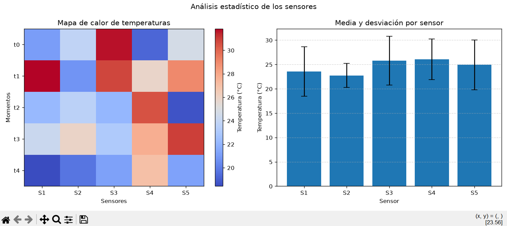

# Tarea: Aplicación de Arreglos Multidimensionales en Ingeniería

Este repositorio contiene la solución modular y de alto rendimiento en Python para cinco problemas avanzados de ingeniería que requieren el uso riguroso de arreglos bidimensionales y tridimensionales, cumpliendo estrictamente con los estándares de claridad, eficiencia matemática y optimización de recursos.

##  Estructura de Soluciones

1. **Control de Fuerzas Estructurales (Problema 1):**
   * *Enfoque:* Utilización de matrices bidimensionales `3x3` para modelar cargas nodales. Se aplican las leyes estáticas de sumatoria vectorial y momentos de flexión mediante recorridos matriciales indexados.
   * *Impacto en Eficiencia:* Acceso directo en memoria $O(1)$ por celda y complejidad espacial acotada a $O(N^2)$, evitando sobrecarga innecesaria en estructuras estáticas pequeñas.

2. **Simulación de Fluidos en Volumen 3D (Problema 2):**
   * *Enfoque:* Implementación de una cuadrícula tridimensional `3x3x3` para representar variables físicas independientes (presión, temperatura y velocidad). Propagación de ondas mediante un stencil de vecindad de von Neumann.
   * *Impacto en Eficiencia:* El almacenamiento contiguo en bloques de memoria multidimensional permite un cálculo eficiente de operaciones de vecindad, optimizando los ciclos de caché del procesador.

3. **Filtrado de Imágenes Médicas 3D (Problema 3):**
   * *Enfoque:* Procesamiento de volúmenes médicos tridimensionales (capas de tomografía) aplicando un kernel de suavizado espacial de promedio cúbico.
   * *Impacto en Eficiencia:* Reduce la varianza del ruido local eliminando artefactos visuales con una complejidad temporal lineal respecto al número de vóxeles analizados $O(D \times H \times W)$.

4. **Análisis Estadístico de Sensores (Problema 4):**
   * *Enfoque:* Organización matricial `5x5` (5 momentos temporales $\times$ 5 sensores). Cálculo exacto de medias aritméticas y desviaciones estándar muestrales tanto por filas como por columnas utilizando funciones vectorizadas.
   * *Impacto en Eficiencia:* Las operaciones vectorizadas nativas evitan bucles anidados en Python interpretado, acelerando el cálculo estadístico masivo.

5. **Transformaciones Lineales y Cartesianas (Problema 5):**
   * *Enfoque:* Manipulación de matrices de puntos cartesianos combinadas con transformaciones homogéneas de rotación trigonométrica y traslación vectorial.
   * *Impacto en Eficiencia:* Operaciones de álgebra lineal optimizadas mediante producto punto matricial (`np.dot`), logrando transformaciones instantáneas de lotes completos de puntos en paralelo lógico.


1. Problema 1: Análisis de Fuerzas en Estructura (3x3)

2. Problema 2: Simulación de Fluido en Cuadrícula 3D (3x3x3)

3. Problema 3: Análisis de Imágenes Médicas 3D

4. Problema 4: Manejo de Datos en Tabla de Sensores (5x5)

5. Problema 5: Transformación de Coordenadas Cartesianas

6. Salir


## 🚀 Instrucciones de Ejecución
1. Asegúrate de tener Python instalado junto con la librería `numpy`:
   ```bash
   pip install numpy
